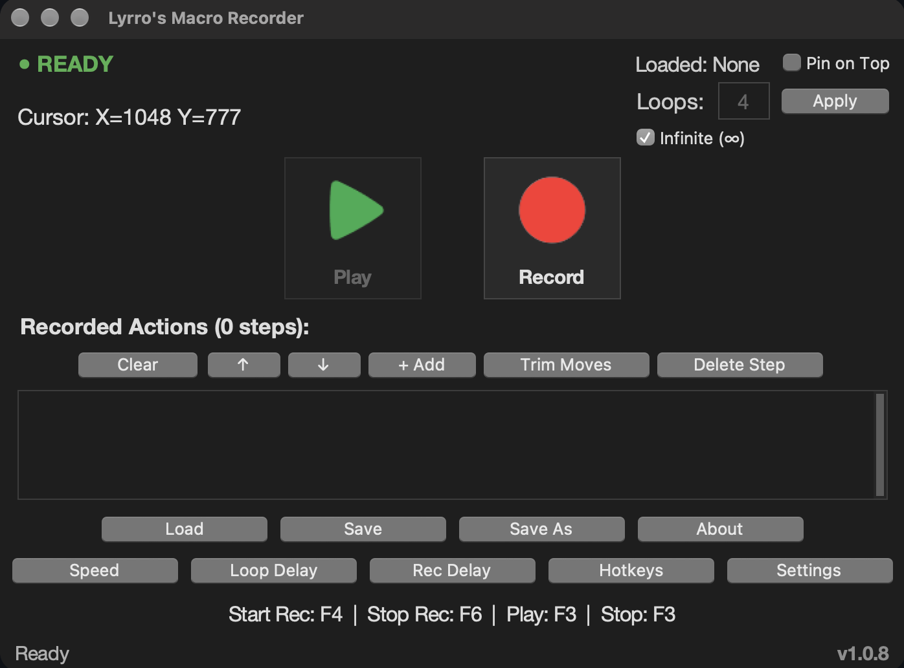

# Lyrro's Macro Recorder

A macOS-focused macro recorder for capturing, editing, and replaying
keyboard and mouse actions.

[Download the latest release](https://github.com/lyrros/Lyrros-Macro-Recorder/releases/latest)
· [Tutorial](TUTORIAL.md)
· [Report a bug](https://github.com/lyrros/Lyrros-Macro-Recorder/issues)

)

## Features

- Record keyboard input, mouse clicks, movement, and scrolling
- Add, edit, reorder, and delete individual macro steps
- Adjust playback speed, loops, and recording delay
- Save macros as `.lmr`; load `.json` and legacy `.pmr` files
- Configure macOS permissions from the app

## Install

1. Download the macOS app ZIP from [Releases](https://github.com/lyrros/Lyrros-Macro-Recorder/releases/latest).
2. Unzip it and open Lyrro's Macro Recorder.
3. Follow the in-app prompts to grant the required macOS permissions.

## About this project

This is a macOS-focused fork of
[PyMacroRecord](https://github.com/LOUDO2/PyMacroRecord), originally created
by LOUDO. The macOS interface and features have been adapted for this project.
